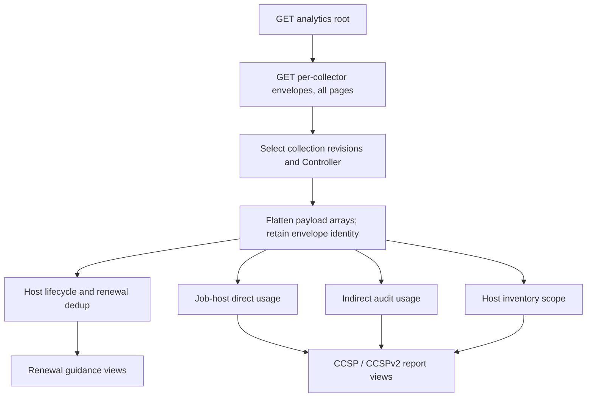

# Reproduce reports from raw analytics data

The analytics API serves raw per-collector payloads, not XLSX reports or
precomputed report tables. This guide maps the existing metrics-utility
**RENEWAL_GUIDANCE**, **CCSP**, and **CCSPv2** reports to those payloads and
describes the transformations to apply after extraction.

The main recipes use **filter, calculated column, join, group, distinct count,
and pivot** operations rather than a particular BI tool or query language.
You do not need metrics-utility or its report builders installed to follow
them. Translate the operations into your BI tool's data-preparation features,
or perform unsupported transformations before importing the prepared tables.
In particular, the default renewal deduplication needs ordered, repeated
matching; an ordinary "remove duplicate rows" operation is not equivalent.

Start with [prepare the inputs](#prepare-the-inputs-in-your-bi-workflow), then
follow [renewal guidance](#renewal-guidance) or [CCSP / CCSPv2](#ccsp--ccspv2).
The worked data shows intermediate results and expected report values without
running code or requiring SQL support in the BI tool.

Use [analytics.md](analytics.md) for discovery, window filters, pagination,
and collection tasks; [analytics-retention.md](analytics-retention.md) for
stored-data retention. In AAP, the API root is
`https://<gateway>/api/metrics/v1/analytics/`; standalone examples use
`/api/v1/analytics/`. GET reads already-persisted data. A System Administrator
can POST to a collector's `collect/` URL if a required collection is missing.
System Auditors can read but cannot trigger collection.

These recipes describe the current report calculations, not new counting or
license-policy rules. Match the metrics-utility version, report options, and
input collection state when comparing a BI result with an existing workbook.

## Prepare the inputs in your BI workflow

1. **Write down the report settings.** Choose one Controller installation,
   the reporting period, the report type, and the views/sheets to reproduce.
   Record the dedup mode and, for renewal, the iteration count, ephemeral
   threshold, and report execution date. For CCSPv2, record any organization
   filter. These choices change calculations; a different workbook layout
   alone does not.
2. **Choose the feeds using the table below.** Renewal's base input is
   `controller.main_hostmetric`. CCSP's base input is
   `controller.job_host_summary`; add inventory, indirect-audit, or event
   feeds only for the selected transformations and views. Collector names
   that look similar are not necessarily interchangeable.
3. **Retrieve the stored collections.** Use discovery to find each feed's
   `rows_url`, then read all its result pages. If the needed collection is
   absent, ask an administrator to trigger it and wait for the task to
   complete. GET does not run a fresh Controller query. Use the collector's
   source-window rules below, not just the report's displayed dates.
4. **Select the intended collection revisions before expanding records.**
   Identify the Controller by `cluster_id` and origin by `source`. Choose
   one revision of each intended window; for a snapshot or renewal lifecycle
   comparison, choose the intended complete observation, not every stored
   observation. Retain the envelope IDs so you can reproduce the same result
   later. The identity rules in the next section explain overlaps and retries.
5. **Turn each selected payload into a staging table.** For these reports,
   the host, summary, audit, and event payloads are arrays: expand each array
   item into one row. Copy its envelope `source`, `cluster_id`, ID, collection
   bounds, and collection finish time onto the row as separate columns.
   Keep the envelope ID separate from the record's own `id`. Keep each feed
   in a separate table initially; do not append different collector shapes
   into one table.
6. **Set types without changing identity values.** Parse timestamps as UTC,
   counters as numbers, `deleted` as a boolean, and IDs as lossless identifiers.
   Preserve nulls as nulls, not the strings `"null"` or `"None"`. Do not
   lowercase or trim hostnames, strip IP addresses, or treat empty strings as
   null unless a recipe explicitly says to. Preserve `facts`,
   `canonical_facts`, and `events` as nested data for the views using them.
7. **Keep detail tables until the recipe says to aggregate.** Counts made
   over envelopes, expanded source records, prepared usage rows, and distinct
   hosts are different measurements. Keep a row-count/checkpoint after each
   filter or join; unexpectedly increasing counts often indicate a many-to-many
   join or a repeated collection revision.

The report can then be built as tables, charts, or pivots in the BI tool. An
XLSX renderer is not required to obtain the report's underlying quantities.
Keep downloaded data and prepared BI copies within the customer's access and
retention controls; they contain host identities and operational details.

## Extract once, then join and aggregate



### Envelope identity is not record identity

1. Follow `next` until null using normal pagination; `page_size` counts
   **envelopes**, not records inside `payload`. Keep the default counted
   pagination for these examples.
2. Retain `source`, `cluster_id`, envelope `id`, `since`, `until`, and
   `finished_at` alongside flattened records. Envelope `id` identifies one
   stored collection; record `id` identifies a Controller object.
3. Work on one known Controller installation at a time. Join IDs with
   `cluster_id` (and `source` if combining origins); do not merge two null
   cluster IDs as if they identified the same Controller. For local collection,
   `cluster_id` is Controller `INSTALL_UUID`, corresponding to the CLI's
   `config.install_uuid`.
4. Every successful collection is appended, including repeated windows. Choose
   the intended revision for each window (for example, latest `finished_at`,
   then envelope `id`), and do not sum repeated snapshots or recollected windows.
   Snapshot rows describe state at collection time, not an event stream.
5. GET `since`/`until` filters overlapping **envelopes**, not records within
   their payloads. Select the intended windows and apply record-level rules
   below. Different collectors filter different source timestamps.

For stateful entities, an explicit BI policy is to retain the latest observed
record per `(source, cluster_id, record_id)` after choosing collection revisions.
For `main_hostmetric`, the SQL can legitimately return several rows with the
same metric `id`: use `(id, host_id)`, since one hostname can match several
inventory hosts. For `main_host_daily`, a latest-state table is not the same as
the report's accumulated inventory scope; retain the required observations.
Do not drop distinct event/host-summary records merely because they share a
hostname or job ID. For the legacy `main_jobevent` feed, retain its selecting
`main_jobhostsummary_id` as well when distinguishing source rows.

Analytics payload history cannot recover source data already deleted from
Controller before collection. Once collected, it follows service retention
independently of Controller's later source cleanup. Export the inputs needed
for a reproducible historical workbook rather than assuming a fresh snapshot
will recreate past state.

## Source feeds and organization join paths

All names in this table are public API collector names. They are available
directly through the analytics API; customers do not install SQL helper
functions or query the Controller database to use these recipes.

"Core" below means needed for the report's base Usage Reporting quantities.
Configurable sheets may still be enabled by the CLI's defaults: optional does
not mean disabled by default. Sheet flags are shown explicitly so you can
select feeds for the views you actually want.

| Feed | Report type | Core use | Optional-sheet / conditional use | Source window / organization |
| --- | --- | --- | --- | --- |
| `controller.main_hostmetric` | Renewal guidance | Lifecycle inputs for Usage Reporting and the selected renewal dedup mode. | `managed_nodes` details: active, deleted and ephemeral views all reuse this same feed. | For renewal, request `since` with `until: null`: the collector can return recent automation **or deletion**. The report then retains only `last_automation >= since`; no native org field. |
| `controller.job_host_summary` | CCSP and CCSPv2 | Direct managed-node quantities in Usage Reporting. | Both: `managed_nodes` and event hostname normalization. CCSPv2: `jobs`, `usage_by_organizations`, `managed_nodes_by_organizations`. | Summary `modified` in `[since, until)`; `organization_remote_id/name` and job/template/inventory/project context. |
| `controller.main_indirectmanagednodeaudit` | CCSP and CCSPv2 | Not needed for direct billing quantities. | Both: `indirectly_managed_nodes`, conditional indirect `usage_by_collections`. CCSPv2: `infrastructure_summary`, and available indirect contributions to `jobs`, `usage_by_organizations`, per-org node tabs. | Related job `finished` in `[since, until)`; executing-job `organization_remote_id/name`. |
| `controller.main_host` | CCSP and CCSPv2; optional renewal context | Needed for hardware mapping **only when** `ccsp-experimental` is selected; not for default `ccsp` quantities. | `inventory_scope`; experimental direct-node facts. Renewal: optional current inventory/org attribution, not lifecycle counting or dedup input. | Current enabled-host snapshot; `organization_remote_id/name` from inventory. |
| `controller.main_host_daily` | CCSP and CCSPv2 | Conditional accumulated hardware observations for `ccsp-experimental`, not default quantities. | Incremental `inventory_scope` and experimental fact history alongside the chosen snapshot. | Enabled hosts created **or** modified in `[since, until)`; same inventory/org fields as `main_host`. |
| `controller.main_jobevent` | CCSP and CCSPv2 | Not needed for billing quantities. | `usage_by_collections`, `usage_by_roles`, `usage_by_modules`. | Runner events selected through summaries whose `modified` is in the window; no native org field. |
| `controller.unified_jobs_dashboard` or `controller.unified_jobs` | Supporting enrichment for CCSP/CCSPv2 analytics | Not a separate core input; summaries already contain job context. | Event-to-job org joins and optional collection-version lookup; not required merely to render `jobs`. | Job `finished` in `[since, until)`; `organization_id/name`. |
| `controller.config` | Optional context for all three | No separate count input: envelope `cluster_id` already supplies installation identity. | Configuration context only; not an org-specific sheet or a source for company/SKU/price parameters. | Fixed-key snapshot object, not an array; not per-org data. |

`controller.job_host_summary_service` is useful for job-finish-aligned
analytics, but lacks `ansible_host_variable` and `ansible_connection_variable`.
It is **not** a drop-in replacement for the CCSP summary feed. Likewise,
`main_jobevent_service` selects a different event set and has job/row caps;
substituting it can change optional content counts.

### Explicit join keys

Use a **left join** when adding optional context, so unmatched records remain
visible instead of silently disappearing. In each case, match `source` and
`cluster_id` as well as the record keys:

| Desired result | Left input | Right input and record-key match | What to retain |
| --- | --- | --- | --- |
| Event's executing organization | Event feed | Job feed: event `job_remote_id` = job `id` (`events_table` uses `job_id` instead) | Job `organization_id/name`; not the current host inventory's org. |
| Current inventory organization for a lifecycle record | `main_hostmetric` | `main_host`: metric `host_id` = host `host_id` | Host `organization_remote_id/name` and inventory membership. A metric's `host_id = 0` has no current host match. |
| Report hostname for an event | `main_jobevent` | Job-host summaries: equal `job_remote_id` and original `host_name` | Summary's non-null `ansible_host_variable`, otherwise the event's original name. Preserve original names before this step. |

In a BI join dialog, select all the matching columns together; matching just
job ID or hostname is not enough. If a lifecycle row has no current host,
keep its lifecycle data with organization marked unavailable. Do not assign
it to the last organization seen on an unrelated same-named host.

First select one intended job row per job ID and the appropriate summary rows,
or those joins multiply records. Fetch matching job IDs even when their
finish-window envelopes differ from the summaries' modification windows;
identical GET bounds do not guarantee identical job coverage.

For report inputs, organization is already present as
`organization_remote_id`, **not** `organization_id`. Job feeds use
`organization_id`. Inventory organization and executing-job organization are
different dimensions; do not silently replace one with the other. The API
does not apply a general organization query filter: filter extracted records
in the BI system.

The original report groups by organization **name**, replacing missing names
with `No organization name`; a BI grouping by ID is often useful but is a
different calculation. A host used by several organizations can count once in
each organization while counting once globally.

These paths complement the [external analytics documentation work](https://redhat.atlassian.net/browse/AAP-89154)
and [API collector reference](analytics.md#enabled-collectors). Global feeds
such as `config`, `counts`, `table_metadata`, `instance_info`,
`projects_by_scm_type`, versions, feature flags, and monthly host summaries
cannot generally be split into organizations. Neither renewal lifecycle
counters nor aggregate global counts become per-org counters by joining to a
current inventory row. Events can be attributed through jobs; lifecycle
metrics can only be associated with the available current host memberships.

## Renewal guidance

```text
controller.main_hostmetric
├── main_hostmetric: first/last automation, counters, deleted state
└── LEFT JOIN main_host.name = main_hostmetric.hostname
    ├── host_id (0 if no current host)
    ├── ansible_host_variable / ansible_connection_variable
    └── ansible_product_serial / ansible_machine_id
        ↓
last_automation >= report since → renewal deduplicator
        ↓
active / deleted / ephemeral views and usage quantities
```

The [renewal-guidance collector](https://github.com/ansible/metrics-utility/blob/devel/metrics_utility/library/collectors/controller/main_hostmetric.py)
already returns the lifecycle/fact join used by the CLI. No additional event
join is necessary to get `first_automation` or `last_automation`.

### Step 1. Select one lifecycle observation

The CLI queries `main_hostmetric` with `since` but **no upper bound**, then
keeps rows with `last_automation >= since`. A row returned only because of
`last_deleted` is dropped if its last automation is older. The report's
`until` controls its displayed range and ephemeral-window calculation; it
does not cap the lifecycle query. For parity, use one complete collection
with those bounds, not a sum of daily metric snapshots. Lifecycle counters
are cumulative; summing snapshots double-counts them.

Do not clamp `first_automation` to report `since` or subtract two snapshots'
counters. These are lifecycle values for hosts qualifying by last automation,
not task counts or active-day counts limited to the displayed report period.

Keep these fields from the selected payload:

| Purpose | Fields |
| --- | --- |
| Identify an input row | `id`, `host_id`, `hostname`, plus installation/origin metadata |
| Match aliases / hardware identity | `ansible_host_variable`, `ansible_product_serial`, `ansible_machine_id` |
| Calculate lifecycle / usage | `first_automation`, `last_automation`, `automated_counter`, `deleted_counter`, `last_deleted`, `deleted` |

### Step 2. Form the host identity groups

For the default `renewal` mode, reproduce this ordered procedure in data
preparation. It is **not** a group by machine ID alone:

1. Replace an empty `ansible_host_variable` with null. Replace empty or
   literal `NA` product serials and machine IDs with null. Do not use null
   values to match hosts to one another.
2. Retain a stable identity for each input row and the collector's order
   (`hostname`, then `host_id`). Start with no rows marked processed.
3. Take the next unprocessed row as a seed. Start a group with all retained
   rows having the same `hostname` as the seed.
4. Expand that group in this order: add rows matching a current group's
   `hostname`, then `ansible_host_variable`, then `ansible_product_serial`,
   then `ansible_machine_id`. Match each field against values in **that same
   field**, not against a combined pool of different identity fields. Use the
   expanded group's values in each following lookup. Keep each input row
   only once within the group.
5. Repeat those four lookups for the configured number of passes (default
   **3**, from `REPORT_RENEWAL_GUIDANCE_DEDUP_ITERATIONS`). Do not continue
   until convergence if the chosen report uses three passes.
6. Mark the group's input rows processed, save the group, and continue with
   the next unprocessed seed. The processed marker controls seed selection;
   the matching lookups still search the whole retained input table.

This is a bounded iterative search, not guaranteed full connected-component
closure. A BI tool without repeated matching needs this transformation in a
preparation step outside its visual/report layer; importing a prepared group
mapping is also possible. Do not silently substitute a simpler grouping and
claim it matches the default report.

The SQL's multiple inventory-host matches remain part of the input; do not
collapse them by metric ID before applying these rules if matching the current
report. No general `ansible_connection_variable == 'local'` exclusion is applied.

Other selectable modes change the result: `renewal-hostname` groups only on
`ansible_host_variable` (falling back to hostname); `renewal-experimental`
starts with hostname grouping, then merges serial/machine-ID matches including
comma-separated values. Choose the same mode as the workbook being compared:

| Mode | Grouping operation to reproduce |
| --- | --- |
| `renewal` (default) | The ordered seed/expansion procedure above. |
| `renewal-hostname` | After the same null cleanup, calculate a key from non-null `ansible_host_variable`, otherwise `hostname`; group on that key. Hardware values do not join separate groups. |
| `renewal-experimental` | Begin with hostname groups; split original serial/machine-ID strings on commas, trim items and discard empty/`NA` items. Build serial/machine pairs and individual serial/machine keys; identify first-seen multi-group matches before individual-value matches. Merge the selected hostname groups, not repeated expanded serial rows. This is order-dependent and is not an arbitrary transitive hardware merge. |

For overlapping experimental matches, the current implementation keeps its
first matching merge for each canonical group, rather than unioning every
connected group. Preserve that ordering when exact experimental-mode parity
is required; do not assume a BI tool's general fuzzy-dedup operation matches it.
The implementation reference is
[renewal_guidance.py](https://github.com/ansible/metrics-utility/blob/devel/metrics_utility/automation_controller_billing/dedup/renewal_guidance.py),
not an extra runtime dependency of this recipe.

### Step 3. Reduce each identity group to one lifecycle row

Create a new table, **deduped lifecycle**, with one row per group. Do this
before deciding whether a host is active, deleted, or ephemeral:

| Output value | Operation on the group's source rows |
| --- | --- |
| Representative `hostname` | Prefer non-deleted rows, then greatest `last_automation`; retain the same input ordering for unresolved ties. |
| `first_automation` | Minimum first automation. |
| `last_automation`, `last_deleted` | Maximum of each timestamp, ignoring missing deletion timestamps. |
| `automated_counter`, `deleted_counter` | Sum each counter over the group's input rows, not over collection envelopes. |
| `deleted` | True only when all group rows are deleted; otherwise false. |
| `hostmetric_record_count` | Number of distinct source hostnames. |
| Active/deleted record counts | Number of distinct source hostnames among non-deleted/deleted rows respectively. A hostname can occur in both subsets. |
| Identity lists | Distinct contributing hostnames, connection-host variables, product serials and machine IDs; retain them for audit/drill-down. |

The first two modes use this representative-hostname rule. When
`renewal-experimental` merges hostname groups, it instead chooses the group
with latest last automation, sums the previously computed record counts, and
combines their identity lists. Those differences matter when comparing modes.

### Step 4. Classify rows and build the report views

After deduplication:

- `days_automated = max(0, floor((last_automation - first_automation) / 1 day))`.
- Without an ephemeral threshold, Automated hosts is the number of distinct
  non-deleted representative hostnames; Deleted Automated hosts counts deleted
  representatives separately.
- With threshold `N`, a host is ephemeral when `days_automated <= N` **and**
  `first_automation <= midnight(report execution date - (N - 1) days)`.
  Recent first automation is therefore not immediately classified ephemeral.
  Active ephemeral/non-ephemeral quantities exclude deleted groups.
- Ephemeral peak usage includes deleted ephemeral groups too. Slide an
  `N`-day interval forward one day at a time within the report's inclusive
  date range. Count distinct representatives whose lifecycle intersects the
  interval (`last_automation >= window_start` and
  `first_automation <= window_end`), then take the maximum.

Execution date is an input to classification, even for a historical report.
The report provides these usage quantities; there is no separate API-provided
renewal recommendation or org-specific allocation of cumulative counters.
Indirect audit data is not an input to this report.

Build Usage Reporting as the quantities below, and detail tables by applying
the corresponding row filters to **deduped lifecycle**:

| Report view / quantity | Which deduped rows to use |
| --- | --- |
| Automated hosts, without `--ephemeral` | Distinct representative hostnames where `deleted` is false. |
| Managed nodes, without `--ephemeral` | Those same non-deleted rows, with lifecycle fields, counters and identity lists. |
| Automated hosts / Managed nodes, with `--ephemeral` | Non-deleted rows classified non-ephemeral. |
| Ephemeral automated hosts total / Managed nodes ephemeral | Non-deleted rows classified ephemeral. |
| Deleted Automated hosts / Deleted Managed nodes | All deleted rows, regardless of ephemeral classification. |
| Ephemeral maximum concurrent usage | Maximum of the sliding-window counts over ephemeral rows, **including deleted ones**. |
| Managed nodes ephemeral usage | One row per sliding window with its start, end and distinct overlapping representative-host count. |

The detail sheets are controlled together by `managed_nodes` in the CLI; in a
BI report they can be separate visuals sharing the same prepared data.

### Worked example: renewal guidance without code

Use this small synthetic dataset to check each stage in any data-preparation
tool. Settings: one installation, report **2026-09-01 through 2026-09-30**,
execution date **2026-10-01**, default `renewal` mode with three passes.

**Import.** Select one complete `controller.main_hostmetric` envelope with
`since = 2026-09-01T00:00:00Z` and `until = null`. For example, an administrator
can request those exact bounds through its collection endpoint. Expand its
payload into the five records below. All dates in this example mean midnight
UTC; `null` is a missing value, not an identity string.

Identity fields (`ansible_host_variable` and `ansible_product_serial` are null
on every row):

| id | host_id | hostname | ansible_machine_id |
| --- | --- | --- | --- |
| 1 | 11 | app-01 | machine-a |
| 2 | 12 | app-alias | machine-a |
| 3 | 13 | burst | machine-b |
| 4 | 0 | retired | null |
| 5 | 0 | old | null |

Lifecycle fields for those same IDs:

| id | first_automation | last_automation | automated_counter | deleted | deleted_counter | last_deleted |
| --- | --- | --- | --- | --- | --- | --- |
| 1 | 2026-09-01 | 2026-09-20 | 5 | false | 0 | null |
| 2 | 2026-09-02 | 2026-09-22 | 3 | false | 0 | null |
| 3 | 2026-09-05 | 2026-09-06 | 2 | false | 0 | null |
| 4 | 2026-09-06 | 2026-09-07 | 1 | true | 1 | 2026-09-08 |
| 5 | 2026-08-01 | 2026-08-31 | 9 | true | 1 | 2026-09-10 |

**Filter.** Remove ID 5: it was returned because of its recent deletion, but
its last automation is before report `since`. Four source rows remain.

**Group and reduce.** IDs 1 and 2 match on `ansible_machine_id`; the other
identity lookups add no rows. IDs 3 and 4 remain separate. In particular,
null machine IDs do not join deleted hosts together. Prefer `app-alias` as the
representative for the first group because its automation is more recent:

| Source IDs | Representative hostname | first_automation | last_automation | automated_counter | deleted | days_automated | Distinct source hostnames |
| --- | --- | --- | --- | --- | --- | --- | --- |
| 1, 2 | app-alias | 2026-09-01 | 2026-09-22 | 8 | false | 21 | 2 |
| 3 | burst | 2026-09-05 | 2026-09-06 | 2 | false | 1 | 1 |
| 4 | retired | 2026-09-06 | 2026-09-07 | 1 | true | 1 | 1 |

**Build the basic views.** Without an ephemeral threshold, Managed nodes has
`app-alias` and `burst`; Deleted Managed nodes has `retired`. Automated hosts
is **2**, and Deleted Automated hosts is **1**. The first group's automation
counter is **8**, not a count of its two aliases or a sum of daily snapshots.

**Add seven-day ephemeral classification.** The execution-date threshold is
2026-09-25. `burst` and `retired` each have one automated day and sufficiently
old first automation, so both are ephemeral. Only `burst` is active.

For peak usage, use the ephemeral lifecycle rows **including** `retired`.
Generate the 24 seven-day windows starting daily from September 1 through
September 24. Some check rows are:

| Window start | Window end, inclusive day | Overlapping ephemeral representatives | Count |
| --- | --- | --- | --- |
| 2026-09-01 | 2026-09-07 | burst, retired | 2 |
| 2026-09-06 | 2026-09-12 | burst, retired | 2 |
| 2026-09-07 | 2026-09-13 | retired | 1 |
| 2026-09-08 | 2026-09-14 | none | 0 |

The final Usage Reporting quantities are:

| Quantity | No ephemeral threshold | Seven-day threshold |
| --- | --- | --- |
| Automated hosts | 2 | 1 |
| Ephemeral automated hosts total | Not shown | 1 |
| Ephemeral maximum concurrent usage | Not shown | 2 |
| Deleted Automated hosts | 1 | 1 |

With the threshold enabled, Managed nodes contains `app-alias`, Managed nodes
ephemeral contains `burst`, Deleted Managed nodes contains `retired`, and
Managed nodes ephemeral usage contains the per-window counts. The peak of 2
and active ephemeral quantity of 1 are intentionally different measurements.

## CCSP / CCSPv2

```text
controller.job_host_summary + envelope.cluster_id
├── reachable-task filter and hostname normalization → direct usage
├── job/org/template references → organization and job views
└── original host + job ID → normalize event hostnames
controller.main_indirectmanagednodeaudit → indirect usage / facts / events
controller.main_host + controller.main_host_daily → inventory scope / serials
controller.main_jobevent → optional content-usage views
```

The CLI reads these datasets from collected tarballs; analytics supplies the
corresponding payloads directly. Preserve the observations/windows used for
that workbook, especially for inventory scope and hardware dedup. A fresh
snapshot does not reproduce a month of historical host facts.

### Step 1. Choose the views and import their inputs

Start with the raw summary feed, not event data or the dashboard API:

| What you want to reproduce | Inputs to prepare |
| --- | --- |
| Direct Usage Reporting and Managed nodes | `controller.job_host_summary`, with installation identity from its envelopes. |
| Inventory Scope, or `ccsp-experimental` hardware matching | Add the intended `controller.main_host` snapshot and `controller.main_host_daily` observations. |
| Indirectly Managed nodes, Infrastructure Summary, or indirect contributions to other views | Add `controller.main_indirectmanagednodeaudit` for the intended job-finish windows. |
| Usage by collections / roles / modules | Add `controller.main_jobevent`; retain summaries for hostname mapping. |
| Company/SKU/price/PO/address columns | Supply report configuration separately; these are not activity measurements. |

Jobs and organization views can be built from summary/audit context without
another jobs collector. A jobs feed is useful for adding organization/version
context to events that do not contain it themselves. Keep the source feeds in
separate staging tables until the following preparation steps are complete.

### Step 2. Prepare direct-host usage

For each `controller.job_host_summary` record:

1. Keep rows where `failures + ok + skipped + ignored + rescued > 0`.
   Unreachable-only (`dark`) rows do not count as managed-node usage.
2. Preserve `original_host_name`; set `host_name` to non-null
   `ansible_host_variable`, falling back to the original name. Unlike renewal's
   cleanup, this path does not turn an empty string into null.
3. Set `task_runs = dark + failures + ok + skipped + ignored + rescued`.
4. Group by `(organization_name, job_template_name, host_name,
   original_host_name, install_uuid, job_remote_id)`; sum task counts, count
   input rows as `host_runs`, and use summary `created` min/max as the report's
   first/last automation. `job_created` uses the maximum job creation time.
5. Save these as **prepared direct usage**, with a calculated source/type
   label `DIRECT`. This label is your preparation result, not an extra field
   returned by the raw summary feed. Keep the original hostname as well as
   the normalized report hostname.

These six grouping keys matter: grouping only by hostname at this stage
loses job, template and organization information needed by the other views.
Retain task totals, first/last automation, job creation time, and source-row
counts on every prepared row. Final report row counts are not necessarily
the same as those source-row counts.

The default `ccsp` deduplicator performs no additional hardware merge.
Normalized hostnames and subsequent `COUNT(DISTINCT host_name)` define the
reported managed nodes. It does not add a generic `connection:local` filter,
machine-ID-only grouping, or an extra delegated-task target scan.

### Step 3. Prepare indirect usage if it is part of your report

Follow [indirect-node attribution](#indirect-node-attribution) below to create
**prepared indirect usage**, using the same six keys as direct usage and a
calculated type `INDIRECT`. Do not derive indirect targets by counting extra
event hostnames. If indirect data is unavailable, keep that limitation visible
instead of treating it as a measured zero.

Combine the prepared branches on those same keys, summing their task/source-row
counts and merging identity/fact/event sets. If an identical key occurs in
both branches, the report's direct type takes precedence; retain the set of
contributing types for detail output. Do not add the type itself to the six
grouping keys if reproducing this merge. Keep direct and indirect output
filters for later, rather than discarding one branch from the shared table.

### Step 4. Prepare inventory scope and any hardware mapping

Combine the required `main_host` snapshot and `main_host_daily` observations.
Normalize hostname as above, then group by `(report_host_name, cluster_id)`:
union organization names, inventory names, `canonical_facts` and `facts`
values, and take maximum `last_automation`. Snapshot/delta rows are **not**
automation runs. Enabled inventory hosts can appear without reachable usage;
inventory scope is not the billable managed-node set.

`ccsp-experimental` additionally builds compound
`ansible_product_serial/ansible_machine_id` keys from `canonical_facts` when
both are non-null. It maps names sharing a compound serial to the first-seen
representative, then regroups summary, event, and scope data. Keep the same
input order for exact parity; this is not an arbitrary machine-ID-only or
global transitive merge. Direct-node facts are enriched from scope during
this mode. See the existing [CCSP deduplicator](https://github.com/ansible/metrics-utility/blob/devel/metrics_utility/automation_controller_billing/dedup/ccsp.py)
and [dataframe engines](https://github.com/ansible/metrics-utility/tree/devel/metrics_utility/automation_controller_billing/dataframe_engine).

In BI preparation, implement that optional mapping as a separate lookup table:

1. For each host observation with both hardware values present, form the
   literal product-serial/machine-ID pair. Do not apply renewal's empty/`NA`
   cleanup here; CCSP's current pair calculation only checks for nulls.
2. Retain the pair set for each normalized hostname/installation. Walk those
   host rows in the same order as the reference report. For each pair, the
   first-seen hostname is its representative; map every matching hostname to
   that representative. A later pair's assignment can overwrite a name's
   earlier mapping. This is not recursive/transitive closure.
3. For experimental direct-node fact columns, attach the accumulated scope
   facts for the original normalized name before replacement. Preserve fact
   values as sets when several observations contribute different values.
4. Left-join that lookup to usage and scope data. Replace only the report
   hostname when a mapping exists, leaving unmatched names unchanged. Preserve
   `original_host_name` for traceability and event matching. Save the same
   lookup for the optional content preparation in Step 6.
5. Repeat each table's own grouping after replacement. In particular, usage
   still has the same six keys, including original hostname; do not collapse
   everything directly to one row per canonical host.

For default `ccsp`, skip the hardware mapping entirely; hostname normalization
from Step 2 still applies. A BI tool cannot assume that having a machine ID
means the workbook used hardware deduplication.

### Step 5. Build the selected report views

Keep an unfiltered copy of deduped usage for event hostname mapping in Step 6.
For CCSPv2, apply the optional organization-name filter to the usage used by
report views **after** deduplication. It does not automatically filter scope
or content tables. Work on one installation; distinct counts below ignore
missing values.

| View | Filter and grouping | Values to calculate |
| --- | --- | --- |
| CCSP Usage Reporting | Direct usage; group by organization name | Distinct report hostnames per org. |
| CCSPv2 Usage Reporting | Direct usage, after any org filter; one overall group | Distinct report hostnames globally, **not** the sum of org quantities. |
| Managed nodes | Direct usage; group by report hostname | Distinct org names; number of prepared rows as Job runs; sum tasks; min/max first/last automation. |
| Indirectly Managed nodes | Indirect usage; group by report hostname | The same counts/dates plus merged target facts, contributing node types and event names. |
| Jobs (CCSPv2) | Available direct and indirect usage; group by org name and job-template name | Distinct `(job_remote_id, install_uuid)` pairs as Job runs; distinct hostnames; number of prepared rows as non-unique hosts; sum tasks; min/max prepared `job_created`. |
| Usage by organizations (CCSPv2) | Available usage; group by org name | Job runs and task totals from both types; direct distinct hosts and direct prepared-row counts. Add the separate indirect host columns when requested. |
| Per-org managed-node tabs (CCSPv2) | Select one org, then group available usage by report hostname | Node-view measures for that org, including indirect rows when present; omit the redundant org-count column. |
| Managed nodes with org details (CCSPv2) | Direct usage grouped by hostname, plus an org-name pivot | Node measures and maximum last automation per host/org; this is enabled alongside the main Managed nodes view. |
| Inventory Scope | The accumulated/deduped scope table | Membership sets, fact sets and last automation; these are not usage counts. |
| Infrastructure Summary (CCSPv2) | Indirect usage grouped by `facts.infra_type`, `facts.infra_bucket`, `facts.device_type` | Distinct targets and number of prepared usage rows; show missing fact categories as `Unknown`. |

At the node-view stage, Job runs is a **count of prepared rows**. At the Jobs
and organization-view stages, it is a **distinct job/installation count**.
Neither is a count of API envelopes. In organization views, task/job totals
can include indirect rows even when separate indirect-host columns are hidden.

For the commercial summary, supply company/SKU/price fields from report
configuration. Round the unit price to two decimal places, then multiply by
the quantity for the row. CCSP prices each org quantity; CCSPv2 prices the
global direct quantity. These are presentation inputs, not additional feeds.

### Worked example: direct CCSP and CCSPv2 views

Use one installation, the September 2026 period, default `ccsp` dedup, and no
organization filter. Start with these five synthetic summary records; all
task counters other than `ok` and `dark` are zero:

| id | organization_name | job_template_name | job_remote_id | host_name | ansible_host_variable | ok | dark |
| --- | --- | --- | --- | --- | --- | --- | --- |
| 1 | Org A | Deploy | 100 | server-a | 192.0.2.10 | 2 | 1 |
| 2 | Org A | Deploy | 100 | server-b | null | 3 | 0 |
| 3 | Org A | Deploy | 101 | server-a | 192.0.2.10 | 1 | 0 |
| 4 | Org B | Maintain | 200 | alias-a | 192.0.2.10 | 4 | 0 |
| 5 | Org A | Deploy | 102 | unreachable | null | 0 | 5 |

The same records have these timestamps:

| id | job_created | created |
| --- | --- | --- |
| 1 | 2026-09-01T10:00:00Z | 2026-09-01T10:01:00Z |
| 2 | 2026-09-01T10:00:00Z | 2026-09-01T10:02:00Z |
| 3 | 2026-09-01T11:00:00Z | 2026-09-01T11:01:00Z |
| 4 | 2026-09-02T12:00:00Z | 2026-09-02T12:01:00Z |
| 5 | 2026-09-01T12:00:00Z | 2026-09-01T12:01:00Z |

**Prepare.** Remove ID 5 because it has no reachable tasks. Normalize IDs
1, 3 and 4 to the same report hostname, `192.0.2.10`; ID 2 remains `server-b`.
The six-key grouping leaves four prepared direct rows. Their task totals
are 3, 3, 1 and 4 respectively: the unreachable task on ID 1 is included
because that row also has reachable work.

**Build Usage Reporting.** The direct quantities are:

| View | Row | Distinct report hostnames | Quantity |
| --- | --- | --- | --- |
| CCSP | Org A | 192.0.2.10, server-b | 2 |
| CCSP | Org B | 192.0.2.10 | 1 |
| CCSPv2 | Overall | 192.0.2.10, server-b | 2 |

Do not add the two org quantities to get CCSPv2's quantity: the shared host
is counted once globally. At a unit price of 2.50, CCSP's org rows are 5.00
and 2.50; CCSPv2's overall row is 5.00.

**Build Managed nodes.** Group the four prepared rows by report hostname:

| Hostname | Organizations | Job runs (prepared rows) | Task runs | First automation | Last automation |
| --- | --- | --- | --- | --- | --- |
| 192.0.2.10 | 2 | 3 | 8 | 2026-09-01T10:01:00Z | 2026-09-02T12:01:00Z |
| server-b | 1 | 1 | 3 | 2026-09-01T10:02:00Z | 2026-09-01T10:02:00Z |

**Build the organization and Jobs views.** Their counts happen to coincide
here because each org has one template; normally Jobs has a separate group
for every org/template pair:

| Organization | Template | Distinct job runs | Unique hosts | Prepared rows | Task runs |
| --- | --- | --- | --- | --- | --- |
| Org A | Deploy | 2 | 2 | 3 | 7 |
| Org B | Maintain | 1 | 1 | 1 | 4 |

In Jobs, Org A's first/last run uses **job creation** (10:00 and 11:00 on
September 1), not the summary creation timestamps used in Managed nodes.
For per-org node tables, filter the prepared rows by org before the final
hostname grouping. In the org-detail pivot, `192.0.2.10` has last automation
11:01 on September 1 for Org A and 12:01 on September 2 for Org B.

**Check Inventory Scope separately.** Suppose the imported host observations
place `192.0.2.10` in inventory A/Org A and inventory B/Org B, and place
`server-b` only in inventory A/Org A. Scope should union those memberships,
not duplicate the shared host's usage rows. An additional enabled but idle
inventory host may appear in scope without increasing either billing quantity.

### Worked extension: include indirect attribution

Add these three synthetic audit rows. They use the same job, template and
organization context as the direct example, but represent separate indirect
targets rather than the direct execution hosts:

| organization_name | job_remote_id | host_name | task_runs | events |
| --- | --- | --- | --- | --- |
| Org A | 100 | vm-x | 2 | ["example.cloud.inspect", "example.cloud.list"] |
| Org A | 101 | vm-y | 3 | ["example.cloud.inspect", "example.other.inspect"] |
| Org B | 200 | vm-x | 1 | ["example.cloud.inspect"] |

Each row has `facts.infra_type = Cloud`, `facts.infra_bucket = Public`, and
`facts.device_type = VM`, with empty `canonical_facts`. Take `job_created`
from the matching job above and set each audit's `created` five minutes later
for this example. After the same six-key preparation, three indirect usage
rows remain. Expected checks:

- **Billing:** direct quantities stay 2 for Org A, 1 for Org B, and 2 globally.
- **Indirectly Managed nodes:** `vm-x` has two organizations, two prepared
  rows and three task runs; `vm-y` has one organization, one row and three
  task runs.
- **Usage by organizations:** Org A still has two distinct jobs, now with
  12 task runs (7 direct + 5 indirect); Org B has one job and 5 task runs
  (4 + 1). Separate indirect unique-host counts are 2 and 1 respectively.
- **Infrastructure Summary:** the Cloud/Public/VM group has **2 unique
  targets** and **3 total prepared rows**. This is not three unique machines.
- **Collection attribution, indirect contribution only:** `example.cloud`
  receives 6 task runs and `example.other` receives 3. The two cloud modules
  in the first row do not duplicate its contribution within one collection.
  The second row's count is attributed to both its collections, so adding
  collection task counts is **not** a distinct total of audit tasks.

These checks separate target identity, executing-job organization, and content
attribution. No hostname-to-current-inventory join is needed to invent an org
for the indirect targets.

### Indirect-node attribution

`controller.main_indirectmanagednodeaudit` is exposed by the analytics API.
Scheduled collection is controlled by `INDIRECT_NODE_COLLECTION`, separately
from API-registry enablement. Controller must also have produced audit data.
An enabled endpoint is not evidence that a window contains any indirect nodes.

For each audit record, `host_name` is the indirect target, `task_runs` is its
audit count, and `canonical_facts`, `facts`, and `events` carry the target facts
and module FQCNs. `job_remote_id`, `job_template_remote_id`,
`inventory_remote_id`, and `organization_remote_id/name` provide attribution.
The organization is from the executing job, not inferred from target hostname;
`host_remote_id` may be null and must not be required for counting targets.

Use the direct-usage grouping keys and created min/max rules for indirect
rows, with managed-node type `INDIRECT`; use `task_runs` directly, with no
reachable-task filter. Keep direct and indirect usage separate for node
sheets. The CCSP/CCSPv2 billing summary counts **direct** nodes; indirect
nodes feed the optional indirect/infrastructure/content/organization views.
For CCSPv2 per-org tabs, the selected organization can contain both types.

Indirect collection attribution comes from audit `events`: expand distinct
collection FQCN prefixes per target, retaining organization/job identity.
It is not a join on a current inventory host. If collection is disabled,
missing, or unpopulated, indirect identities, facts, event attribution, and
indirect counts are **unavailable for that window**, not proven zero. Keep
that distinction in BI outputs. Existing persisted rows may remain available
after scheduled collection is disabled.

### Step 6. Build optional content views

Skip this step if no collection/role/module view is needed. Otherwise prepare
`controller.main_jobevent` records as follows:

1. Keep records with non-null `task_action` and `host_name`. This initial
   filter is on the original action, before applying the resolved-action
   fallback; do not replace it with a filter on a different event feed.
2. Calculate `module_name` from non-null `resolved_action`, otherwise
   `task_action`. Calculate a role candidate from non-null `resolved_role`,
   otherwise `role`. Preserve case rather than normalizing all names to lower
   case.
3. For a qualified module name, use its namespace and collection prefix as
   `collection_name`. Unqualified/unrecognized names get `No collection used`.
   Normalize a collection role to `namespace.collection.role` (first three
   components), or retain a valid two-component standalone role. Unrecognized
   or missing roles get `No role used`. Do not infer a private/unqualified
   collection name from a display label.
4. Parse `duration` as numeric seconds. Group by
   `(host_name, module_name, collection_name, role_name, install_uuid,
   job_remote_id)`. Count the contributing records as `task_runs` and sum
   duration, using zero for missing duration. This creates **prepared
   content**, not one row per raw task result anymore.
5. If using `ccsp-experimental`, apply the saved hardware hostname mapping
   and regroup on those same keys. Then map event hostnames through the
   unfiltered, deduped usage table's original hostname + job/installation
   keys, retaining the current name if there is no match. This reproduces
   summary-based `ansible_host` normalization without querying Controller.
6. Build the final view by grouping prepared content on the selected label:

| View | Group on | Measures |
| --- | --- | --- |
| Usage by collections | `collection_name` | Distinct report hostnames; distinct `(report hostname, install_uuid, job_remote_id)` combinations; sum task runs; sum duration. |
| Usage by roles | `role_name` | The same four measures. |
| Usage by modules | `module_name` | The same four measures. |

For the collection view, include indirect attribution when reproducing a
workbook with `indirectly_managed_nodes` selected: expand each prepared
indirect row to its **distinct collection prefixes** from `events`, attribute
that row's task count to every prefix, and give it duration zero. Append those
contributions before the final collection grouping. Do not expand indirect
audit events into the role or module views; the existing reports do not do
that. The worked extension above shows why collection-attributed task totals
cannot simply be added to infer a distinct overall task count.

If you also want collection **versions**, add them as a separate enrichment:
match events to jobs on installation/job ID, derive the resolved module's
collection prefix, and look up that key in the job's `installed_collections`
object. Unknown/unqualified names have no inferred version. This is a
customer-side lookup, not an event collector column or a new report input.

### Step 7. Check the result before publishing it

- Compare the same installation, selected envelope revisions, report period,
  options and dedup mode. A current-state host snapshot is not a historical
  membership reconstruction.
- Check intermediate row counts: after source-revision selection, reachable
  filtering, six-key grouping, optional hardware mapping, and final grouping.
  Do not count one full payload as one job or host.
- Compare the matching measure, not just a similarly named column. Node Job
  runs counts prepared rows; Jobs/organization Job runs counts distinct job
  identities. A per-org total can count a shared host in several orgs while
  the global billing quantity counts it once.
- Keep unavailable indirect data visibly unavailable, and keep org-less
  lifecycle/global measurements separate from attributed job usage.
- Check organization-filter scope explicitly: current CCSPv2 usage filtering
  does not imply the same filter was applied to content or Inventory Scope.

`data_collection_status.csv` is CLI packaging metadata, **not** an analytics
collector. Its exact CCSPv2 sheet cannot be reconstructed from successful
`AnalyticsPayload` envelopes: those do not encode failed gather attempts or
the CLI's CSV status rows. API envelope bounds can support your own coverage
check, but do not claim it is that sheet. XLSX styling is also outside the
raw data contract; the recipes reproduce values and groupings, not identical
spreadsheet formatting.
