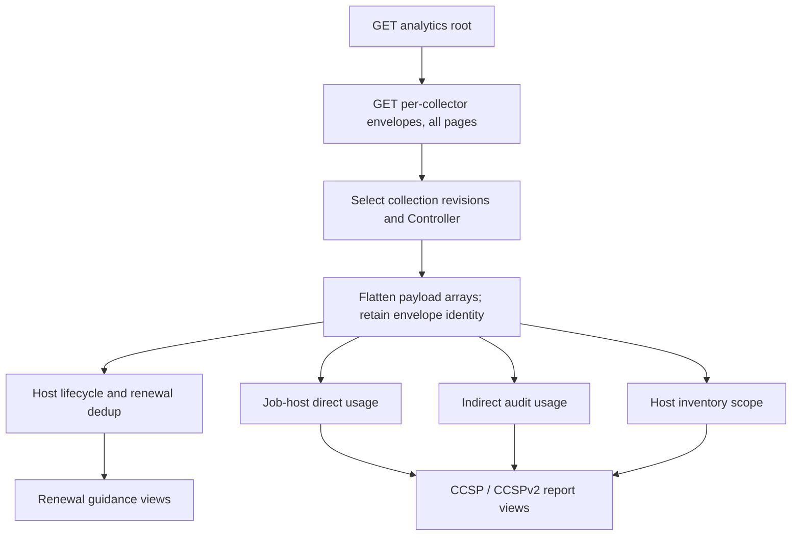

# Reproduce reports from raw analytics data

The analytics API serves raw per-collector payloads, not XLSX reports or
precomputed report tables. This guide maps the existing metrics-utility
**RENEWAL_GUIDANCE**, **CCSP**, and **CCSPv2** reports to those payloads and
describes the transformations to apply after extraction.

Use [analytics.md](analytics.md) for discovery, window filters, pagination,
and collection tasks; [analytics-retention.md](analytics-retention.md) for
stored-data retention. In AAP, the API root is
`https://<gateway>/api/metrics/v1/analytics/`; standalone examples use
`/api/v1/analytics/`. GET reads already-persisted data. A System Administrator
can POST to a collector's `collect/` URL if a required collection is missing.
System Auditors can read but cannot trigger collection.

These recipes describe the current report calculations, not new counting or
license-policy rules. Match the metrics-utility version, report options, and
input collection state when comparing a BI result with an existing workbook.

## Extract once, then join and aggregate



### Envelope identity is not record identity

1. Follow `next` until null using normal pagination; `page_size` counts
   **envelopes**, not records inside `payload`. Keep the default counted
   pagination for these examples.
2. Retain `source`, `cluster_id`, envelope `id`, `since`, `until`, and
   `finished_at` alongside flattened records. Envelope `id` identifies one
   stored collection; record `id` identifies a Controller object.
3. Work on one known Controller installation at a time. Join IDs with
   `cluster_id` (and `source` if combining origins); do not merge two null
   cluster IDs as if they identified the same Controller. For local collection,
   `cluster_id` is Controller `INSTALL_UUID`, corresponding to the CLI's
   `config.install_uuid`.
4. Every successful collection is appended, including repeated windows. Choose
   the intended revision for each window (for example, latest `finished_at`,
   then envelope `id`), and do not sum repeated snapshots or recollected windows.
   Snapshot rows describe state at collection time, not an event stream.
5. GET `since`/`until` filters overlapping **envelopes**, not records within
   their payloads. Select the intended windows and apply record-level rules
   below. Different collectors filter different source timestamps.

For stateful entities, an explicit BI policy is to retain the latest observed
record per `(source, cluster_id, record_id)` after choosing collection revisions.
For `main_hostmetric`, the SQL can legitimately return several rows with the
same metric `id`: use `(id, host_id)`, since one hostname can match several
inventory hosts. For `main_host_daily`, a latest-state table is not the same as
the report's accumulated inventory scope; retain the required observations.
Do not drop distinct event/host-summary records merely because they share a
hostname or job ID. For the legacy `main_jobevent` feed, retain its selecting
`main_jobhostsummary_id` as well when distinguishing source rows.

Analytics payload history cannot recover source data already deleted from
Controller before collection. Once collected, it follows service retention
independently of Controller's later source cleanup. Export the inputs needed
for a reproducible historical workbook rather than assuming a fresh snapshot
will recreate past state.

## Source feeds and organization join paths

All names in this table are public API collector names. They are available
directly through the analytics API; customers do not install SQL helper
functions or query the Controller database to use these recipes.

| Feed | Report role | Source window / organization |
| --- | --- | --- |
| `controller.main_hostmetric` | Renewal lifecycle and dedup inputs | Daily-capable; `last_automation` **or** `last_deleted` in the requested window. No native organization field. |
| `controller.job_host_summary` | CCSP/CCSPv2 direct usage | Summary `modified` in `[since, until)`; includes `organization_remote_id/name`, connection variables, and job/template/inventory/project context. |
| `controller.main_indirectmanagednodeaudit` | Indirect-node usage, facts, and content attribution | Related job `finished` in `[since, until)`; includes `organization_remote_id/name` from the job. |
| `controller.main_host` | Inventory-scope snapshot and optional hardware dedup | Current enabled inventory hosts; `organization_remote_id/name` from inventory. |
| `controller.main_host_daily` | Incremental inventory-scope observations | Enabled hosts created **or** modified in `[since, until)`; same fields/org path as `main_host`. |
| `controller.main_jobevent` | Existing reports' optional collection/role/module usage | Runner events selected through job-host summaries whose `modified` is in the window. No native organization field. |
| `controller.unified_jobs_dashboard` or `controller.unified_jobs` | Job context for BI-side event/org joins | Job `finished` in `[since, until)`; `organization_id/name`. Not required for CCSP direct usage, whose summary feed already has context. |
| `controller.config` | Configuration / installation context | Fixed-key snapshot object, not an array; installation identity, not per-org data. |

`controller.job_host_summary_service` is useful for job-finish-aligned
analytics, but lacks `ansible_host_variable` and `ansible_connection_variable`.
It is **not** a drop-in replacement for the CCSP summary feed. Likewise,
`main_jobevent_service` selects a different event set and has job/row caps;
substituting it can change optional content counts.

### Explicit join keys

After flattening into BI tables named `events`, `jobs`, `summaries`, `hosts`,
and `host_metrics`:

```sql
-- Event organization from its job, not from the current host's inventory.
SELECT e.*, j.organization_id, j.organization_name
FROM events AS e
LEFT JOIN jobs AS j
  ON j.source = e.source AND j.cluster_id = e.cluster_id
 AND j.id = e.job_remote_id;

-- Current inventory organization for a renewal host-metric row.
-- This is one-to-many and is not historical automation attribution.
SELECT m.id AS host_metric_id, m.hostname, h.organization_remote_id,
       h.organization_name, h.inventory_remote_id
FROM host_metrics AS m
LEFT JOIN hosts AS h
  ON h.source = m.source AND h.cluster_id = m.cluster_id
 AND h.host_id = m.host_id;

-- Event hostname normalization used by the report:
-- preserve original_host_name before replacing it with ansible_host_variable.
SELECT e.id, COALESCE(s.ansible_host_variable, e.host_name) AS report_host_name
FROM events AS e
LEFT JOIN summaries AS s
  ON s.source = e.source AND s.cluster_id = e.cluster_id
 AND s.job_remote_id = e.job_remote_id AND s.host_name = e.host_name;
```

First select one intended job row per job ID and the appropriate summary rows,
or those joins multiply records. Fetch matching job IDs even when their
finish-window envelopes differ from the summaries' modification windows;
identical GET bounds do not guarantee identical job coverage.

For report inputs, organization is already present as
`organization_remote_id`, **not** `organization_id`. Job feeds use
`organization_id`. Inventory organization and executing-job organization are
different dimensions; do not silently replace one with the other. The API
does not apply a general organization query filter: filter extracted records
in the BI system.

The original report groups by organization **name**, replacing missing names
with `No organization name`; a BI grouping by ID is often useful but is a
different calculation. A host used by several organizations can count once in
each organization while counting once globally.

These paths complement the [external analytics documentation work](https://redhat.atlassian.net/browse/AAP-89154)
and [API collector reference](analytics.md#enabled-collectors). Global feeds
such as `config`, `counts`, `table_metadata`, `instance_info`,
`projects_by_scm_type`, versions, feature flags, and monthly host summaries
cannot generally be split into organizations. Neither renewal lifecycle
counters nor aggregate global counts become per-org counters by joining to a
current inventory row. Events can be attributed through jobs; lifecycle
metrics can only be associated with the available current host memberships.

## Renewal guidance

```text
controller.main_hostmetric
├── main_hostmetric: first/last automation, counters, deleted state
└── LEFT JOIN main_host.name = main_hostmetric.hostname
    ├── host_id (0 if no current host)
    ├── ansible_host_variable / ansible_connection_variable
    └── ansible_product_serial / ansible_machine_id
        ↓
last_automation >= report since → renewal deduplicator
        ↓
active / deleted / ephemeral views and usage quantities
```

The [renewal-guidance collector](https://github.com/ansible/metrics-utility/blob/devel/metrics_utility/library/collectors/controller/main_hostmetric.py)
already returns the lifecycle/fact join used by the CLI. No additional event
join is necessary to get `first_automation` or `last_automation`.

### Selection and deduplication

The CLI queries `main_hostmetric` with `since` but **no upper bound**, then
keeps rows with `last_automation >= since`. A row returned only because of
`last_deleted` is dropped if its last automation is older. The report's
`until` controls its displayed range and ephemeral-window calculation; it
does not cap the lifecycle query. For parity, use one complete collection
with those bounds, not a sum of daily metric snapshots. Lifecycle counters
are cumulative; summing snapshots double-counts them.

The default `renewal` deduplicator:

1. Converts empty `ansible_host_variable` to null, and empty/`NA` product
   serials and machine IDs to null.
2. Seeds a group with equal `hostname`, then expands matches on `hostname`,
   `ansible_host_variable`, `ansible_product_serial`, and `ansible_machine_id`,
   in that order, for `REPORT_RENEWAL_GUIDANCE_DEDUP_ITERATIONS` passes
   (default **3**). Null keys do not create matches. This is a bounded
   iterative search, not a guaranteed full connected-component closure.
3. Chooses a representative hostname preferring non-deleted records, then
   latest `last_automation`.
4. Uses minimum `first_automation`, maximum `last_automation/last_deleted`,
   sums automation/deletion counters over input rows, and marks the group
   deleted only if all rows are deleted. Record-count columns count distinct
   hostnames, including active/deleted subsets; identity fields are unions.

The SQL's multiple inventory-host matches remain part of the input; do not
collapse them by metric ID before applying these rules if matching the current
report. No general `ansible_connection_variable == 'local'` exclusion is applied.

Other selectable modes change the result: `renewal-hostname` groups only on
`ansible_host_variable` (falling back to hostname); `renewal-experimental`
starts with hostname grouping, then merges serial/machine-ID matches including
comma-separated values. Match the selected implementation in
[renewal_guidance.py](https://github.com/ansible/metrics-utility/blob/devel/metrics_utility/automation_controller_billing/dedup/renewal_guidance.py),
rather than assuming the default algorithm applies to every workbook.

### Active, deleted, and ephemeral quantities

After deduplication:

- `days_automated = max(0, floor((last_automation - first_automation) / 1 day))`.
- Without an ephemeral threshold, Automated hosts is the number of distinct
  non-deleted representative hostnames; Deleted Automated hosts counts deleted
  representatives separately.
- With threshold `N`, a host is ephemeral when `days_automated <= N` **and**
  `first_automation <= midnight(report execution date - (N - 1) days)`.
  Recent first automation is therefore not immediately classified ephemeral.
  Active ephemeral/non-ephemeral quantities exclude deleted groups.
- Ephemeral peak usage includes deleted ephemeral groups too. Slide an
  `N`-day interval forward one day at a time within the report's inclusive
  date range. Count distinct representatives whose lifecycle intersects the
  interval (`last_automation >= window_start` and
  `first_automation <= window_end`), then take the maximum.

Execution date is an input to classification, even for a historical report.
The report provides these usage quantities; there is no separate API-provided
renewal recommendation or org-specific allocation of cumulative counters.
Indirect audit data is not an input to this report.

### Worked example: analytics envelope to renewal workbook

This example uses the existing metrics-utility dataframe, dedup, and XLSX
implementations as the reference calculation. It requires a matching
metrics-utility installation (available in the metrics-service development
environment), not Controller DB access. Protect the downloaded data and
workbook as customer data.

If needed, an administrator first requests a full lifecycle collection:

```http
POST /api/metrics/v1/analytics/controller.main_hostmetric/collect/
Content-Type: application/json

{"since": "2026-09-01T00:00:00Z", "until": null}
```

Wait for the returned task to complete. Use the GET feed to identify its stored
envelope ID, then export that **one complete envelope**, not just `payload`.
The following Python snippet follows every page and selects an explicit ID;
set `AAP_TOKEN`, `ANALYTICS_ROOT`, and `PAYLOAD_ID` in the environment first.
`ANALYTICS_ROOT` is the HTTPS analytics-root URL ending in `/`.

```python
import json
import os
from pathlib import Path
from urllib.parse import urljoin, urlsplit

import requests

root = os.environ["ANALYTICS_ROOT"]
url = urljoin(root, "controller.main_hostmetric/")
origin = urlsplit(root)
assert origin.scheme == "https", "Use an HTTPS Gateway URL"
payload_id = int(os.environ["PAYLOAD_ID"])
with requests.Session() as session:
    session.headers["Authorization"] = f"Bearer {os.environ['AAP_TOKEN']}"
    while url:
        target = urlsplit(url)
        assert (target.scheme, target.netloc) == (origin.scheme, origin.netloc)
        response = session.get(url, timeout=60, allow_redirects=False)
        response.raise_for_status()
        page = response.json()
        match = next((row for row in page["results"] if row["id"] == payload_id), None)
        if match is not None:
            Path("host-metrics-envelope.json").write_text(json.dumps(match))
            break
        url = urljoin(url, page["next"]) if page["next"] else None
    else:
        raise SystemExit("Envelope not found in retained data")
```

Run the [example adapter](examples/renewal_guidance.py) from a metrics-service
checkout with its dependencies installed:

```bash
uv run python docs/examples/renewal_guidance.py host-metrics-envelope.json \
  --since 2026-09-01 --until 2026-09-30 --output renewal-guidance.xlsx
```

It validates the collector, installation identity, and collection bounds,
applies the CLI's `last_automation` filter, runs the default three-pass renewal
deduplication, and writes the Usage Reporting, Managed nodes, and Deleted
Managed nodes sheets. Add `--ephemeral 7` for the existing ephemeral views.
It never triggers collection or connects to Controller. To compare ephemeral
output, run it on the same execution date as the CLI workbook.

## CCSP / CCSPv2

```text
controller.job_host_summary + envelope.cluster_id
├── reachable-task filter and hostname normalization → direct usage
├── job/org/template references → organization and job views
└── original host + job ID → normalize event hostnames
controller.main_indirectmanagednodeaudit → indirect usage / facts / events
controller.main_host + controller.main_host_daily → inventory scope / serials
controller.main_jobevent → optional content-usage views
```

The CLI reads these datasets from collected tarballs; analytics supplies the
corresponding payloads directly. Preserve the observations/windows used for
that workbook, especially for inventory scope and hardware dedup. A fresh
snapshot does not reproduce a month of historical host facts.

### Direct usage and the default dedup mode

For each `controller.job_host_summary` record:

1. Keep rows where `failures + ok + skipped + ignored + rescued > 0`.
   Unreachable-only (`dark`) rows do not count as managed-node usage.
2. Preserve `original_host_name`; set `host_name` to non-null
   `ansible_host_variable`, falling back to the original name. Unlike renewal's
   cleanup, this path does not turn an empty string into null.
3. Set `task_runs = dark + failures + ok + skipped + ignored + rescued`.
4. Group by `(organization_name, job_template_name, host_name,
   original_host_name, install_uuid, job_remote_id)`; sum task counts, count
   input rows as `host_runs`, and use summary `created` min/max as the report's
   first/last automation. `job_created` uses the maximum job creation time.
5. Render report views from those grouped rows, not directly from raw events.

The default `ccsp` deduplicator performs no additional hardware merge.
Normalized hostnames and subsequent `COUNT(DISTINCT host_name)` define the
reported managed nodes. It does not add a generic `connection:local` filter,
machine-ID-only grouping, or an extra delegated-task target scan.

Here are copy-pasteable PostgreSQL queries over the flattened `summaries` table
defined above. Select one installation and the intended modification-window
records before creating `ccsp_direct`:

```sql
CREATE TEMP VIEW ccsp_direct AS
SELECT source, cluster_id,
       COALESCE(organization_name, 'No organization name') AS organization_name,
       job_template_name, job_remote_id, host_name AS original_host_name,
       COALESCE(ansible_host_variable, host_name) AS report_host_name,
       COUNT(*) AS host_runs,
       SUM(dark + failures + ok + skipped + ignored + rescued) AS task_runs,
       MIN(created) AS first_automation, MAX(created) AS last_automation,
       MAX(job_created) AS job_created
FROM summaries
WHERE failures + ok + skipped + ignored + rescued > 0
GROUP BY source, cluster_id, COALESCE(organization_name, 'No organization name'),
         job_template_name, job_remote_id, host_name,
         COALESCE(ansible_host_variable, host_name);

-- CCSP Usage Reporting: quantity per organization name.
SELECT organization_name, COUNT(DISTINCT report_host_name) AS quantity_consumed
FROM ccsp_direct
GROUP BY organization_name;

-- CCSPv2 Usage Reporting: one overall direct managed-node quantity.
SELECT COUNT(DISTINCT report_host_name) AS quantity_consumed FROM ccsp_direct;

-- Managed nodes: the report counts grouped rows as Job runs at this stage.
SELECT report_host_name, COUNT(DISTINCT organization_name) AS organizations,
       COUNT(*) AS job_runs, SUM(task_runs) AS task_runs,
       MIN(first_automation) AS first_automation,
       MAX(last_automation) AS last_automation
FROM ccsp_direct
GROUP BY report_host_name;

-- managed_nodes_by_organizations: repeat the node view within each org.
SELECT organization_name, report_host_name, COUNT(*) AS job_runs,
       SUM(task_runs) AS task_runs, MIN(first_automation) AS first_automation,
       MAX(last_automation) AS last_automation
FROM ccsp_direct
GROUP BY organization_name, report_host_name;
```

CCSP prices each org quantity; CCSPv2 prices the global direct quantity.
Company/SKU/price/PO/address fields come from report configuration, not these
feeds. CCSPv2's organization filter applies to usage rows; it does not
automatically filter inventory scope or optional event-content sheets.

### Inventory scope and experimental hardware dedup

Combine the required `main_host` snapshot and `main_host_daily` observations.
Normalize hostname as above, then group by `(report_host_name, cluster_id)`:
union organization names, inventory names, `canonical_facts` and `facts`
values, and take maximum `last_automation`. Snapshot/delta rows are **not**
automation runs. Enabled inventory hosts can appear without reachable usage;
inventory scope is not the billable managed-node set.

For example, the membership portion of `inventory_scope` is:

```sql
SELECT cluster_id, COALESCE(ansible_host_variable, host_name) AS report_host_name,
       ARRAY_AGG(DISTINCT COALESCE(organization_name, 'No organization name')) AS organizations,
       ARRAY_AGG(DISTINCT inventory_name) AS inventories,
       MAX(last_automation) AS last_automation
FROM hosts
GROUP BY cluster_id, COALESCE(ansible_host_variable, host_name);
```

`ccsp-experimental` additionally builds compound
`ansible_product_serial/ansible_machine_id` keys from `canonical_facts` when
both are non-null. It maps names sharing a compound serial to the first-seen
representative, then regroups summary, event, and scope data. Keep the same
input order for exact parity; this is not an arbitrary machine-ID-only or
global transitive merge. Direct-node facts are enriched from scope during
this mode. See the existing [CCSP deduplicator](https://github.com/ansible/metrics-utility/blob/devel/metrics_utility/automation_controller_billing/dedup/ccsp.py)
and [dataframe engines](https://github.com/ansible/metrics-utility/tree/devel/metrics_utility/automation_controller_billing/dataframe_engine).

### Indirect-node attribution

`controller.main_indirectmanagednodeaudit` is exposed by the analytics API.
Scheduled collection is controlled by `INDIRECT_NODE_COLLECTION`, separately
from API-registry enablement. Controller must also have produced audit data.
An enabled endpoint is not evidence that a window contains any indirect nodes.

For each audit record, `host_name` is the indirect target, `task_runs` is its
audit count, and `canonical_facts`, `facts`, and `events` carry the target facts
and module FQCNs. `job_remote_id`, `job_template_remote_id`,
`inventory_remote_id`, and `organization_remote_id/name` provide attribution.
The organization is from the executing job, not inferred from target hostname;
`host_remote_id` may be null and must not be required for counting targets.

Use the direct-usage grouping keys and created min/max rules for indirect
rows, with managed-node type `INDIRECT`; use `task_runs` directly, with no
reachable-task filter. Keep direct and indirect usage separate for node
sheets. The CCSP/CCSPv2 billing summary counts **direct** nodes; indirect
nodes feed the optional indirect/infrastructure/content/organization views.
For CCSPv2 per-org tabs, the selected organization can contain both types.

Indirect collection attribution comes from audit `events`: expand distinct
collection FQCN prefixes per target, retaining organization/job identity.
It is not a join on a current inventory host. If collection is disabled,
missing, or unpopulated, indirect identities, facts, event attribution, and
indirect counts are **unavailable for that window**, not proven zero. Keep
that distinction in BI outputs. Existing persisted rows may remain available
after scheduled collection is disabled.

### Optional content and metadata sheets

- `controller.main_jobevent` supplies module/collection/role usage. Keep rows
  with non-null `task_action` and `host_name`; prefer `resolved_action` and
  `resolved_role` where present. Collection is the module's FQCN prefix; role
  normalization follows the metrics-utility content dataframe. Group by
  host/module/collection/role/installation/job; count rows and sum `duration`
  (missing duration becomes zero). Apply the summary-based hostname mapping
  above before final view aggregation.
- For version-aware BI enrichment, join events to jobs on installation/job ID,
  then look up the resolved module's collection prefix in the job's
  `installed_collections` object. Unknown/unqualified names have no inferred
  version. This is a customer-side join, not an event collector column.
- `data_collection_status.csv` is CLI packaging metadata, **not** an analytics
  collector. Its exact CCSPv2 sheet cannot be reconstructed from successful
  `AnalyticsPayload` envelopes: those do not encode failed gather attempts or
  the CLI's CSV status rows. API envelope bounds can support your own coverage
  check, but do not claim it is that sheet.
- XLSX styling and report configuration are not collector data. Use the
  [existing report builders](https://github.com/ansible/metrics-utility/tree/devel/metrics_utility/automation_controller_billing/report)
  when an identical workbook layout is required.
