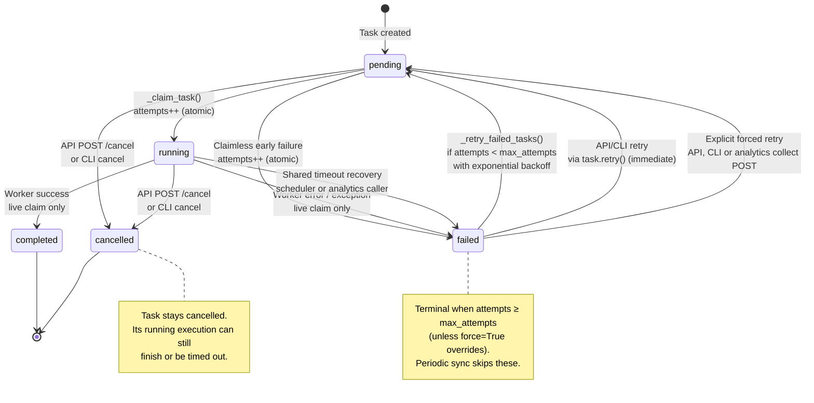
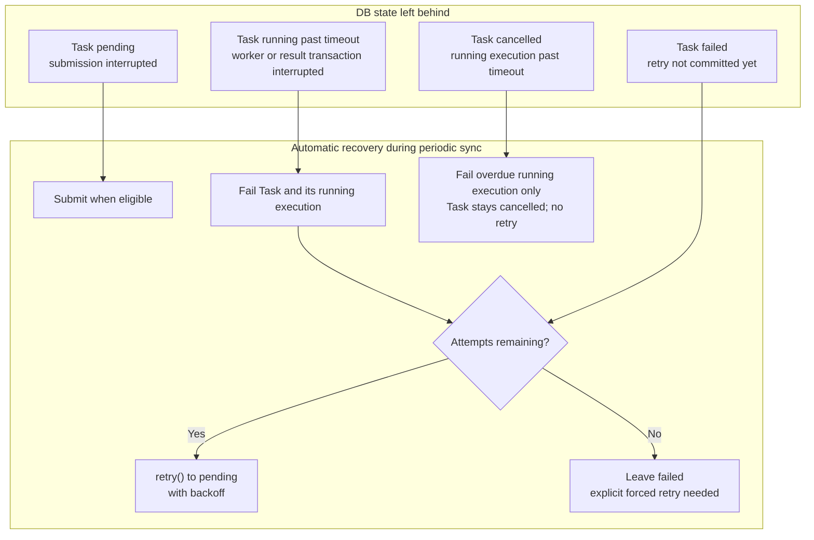
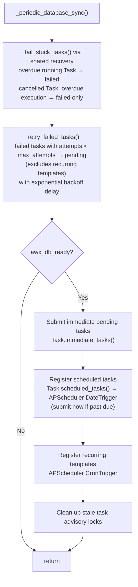
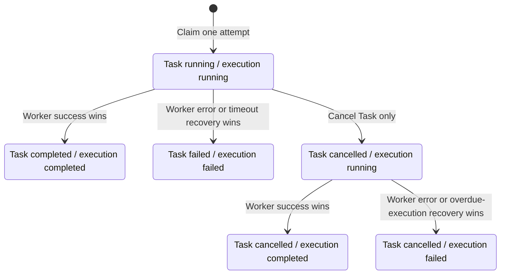
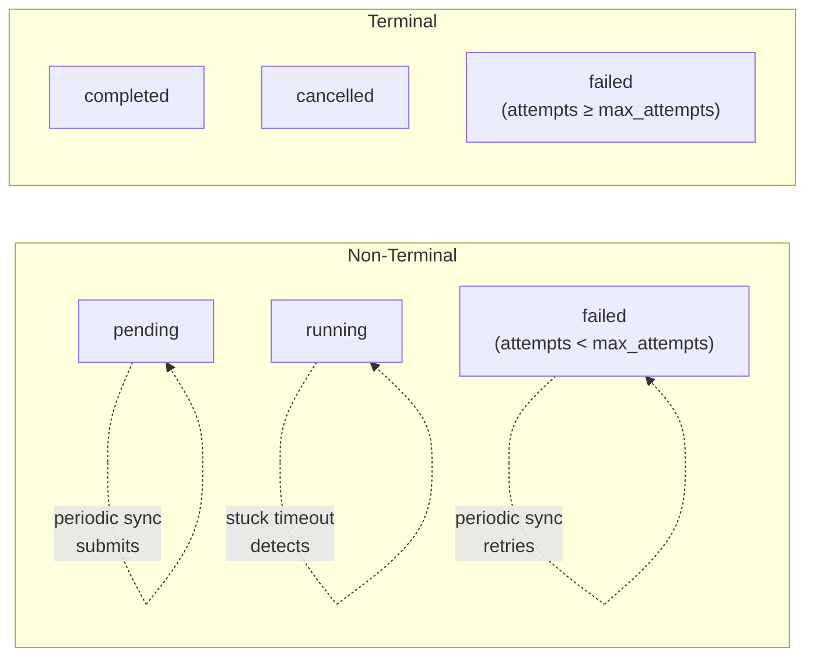

# Task State Machine

The task system uses five Task states. The periodic sync uses persisted state to
recover interrupted submission and execution, subject to scheduling gates and
the retry budget. Task status and execution-attempt status are distinct: cancelling
a Task does not stop its worker or immediately finalize its execution.

## 1. Core State Machine



This is the executable Task's state machine, not its worker's lifetime. Worker
result writes require the live execution claim; rejected late writes leave the
Task unchanged. Forced retry still requires `failed` status and bypasses only the
attempt budget, not the terminal-state guards.

## 2. Task Types and Entry Paths

Every task is a `Task` row. Three shapes exist, distinguished by `scheduled_time`
and `cron_expression`. Immediate and scheduled rows are executable tasks; a
recurring row is a schedule definition that creates executable one-shot children.
Those children follow the same state machine as other one-shot tasks.

| Type | `scheduled_time` | `cron_expression` | Query | How it enters |
|------|------------------|-------------------|-------|---------------|
| Immediate | `NULL` | `NULL` | `Task.immediate_tasks()` | Periodic sync submits it to the dispatcher right away |
| Scheduled | set | `NULL` | `Task.scheduled_tasks()` | APScheduler `DateTrigger` at `scheduled_time` (submitted immediately if past due; may re-submit each sync until claimed) |
| Recurring | `NULL` | set | `Task.recurring_tasks()` | APScheduler `CronTrigger` — the row is a template, see below |

### Recurring tasks are templates

A recurring task (non-empty `cron_expression`) **never runs itself**. On each cron fire,
`_execute_database_task()` creates a fresh one-shot child `Task`
(`cron_expression=None`, `scheduled_time=None`) and submits *that*; the recurring
row remains `pending` while active. A template can also be cancelled: the scheduler
stops dispatching it when it observes that status. Cancellation does not undo a
dispatch already in progress or cancel children already created.

The child is therefore an ordinary **immediate** task and runs through the full
state machine — claim, execute, fail, retry — exactly like any other. It is not a
special case; only the *template* is:

- Timeout recovery cannot fail a template: it is never claimed and has no running
  execution of its own.
- `_retry_failed_tasks()` uses `Task.non_recurring_filter()` to exclude templates;
  their children fail and retry normally. The helper treats both null and legacy
  empty cron expressions as non-recurring.

Wherever this doc says a transition is "non-recurring only," it means the special-cased
template is skipped — the recurring task's spawned children are still fully processed.

### Retried tasks become scheduled

`retry(delay_seconds=N)` sets `scheduled_time = now + N`, so a failed task waiting out
its backoff delay is effectively a **scheduled** task until the delay elapses
(`ready_to_run()` won't claim it before `scheduled_time`).

## 3. Transitions Reference

| # | From | To | Trigger | Code | attempts? |
|---|------|----|---------|------|-----------|
| 1 | `pending` | `running` | Dispatcher worker picks up task | `tasks_system.py:_claim_task()` | +1 (atomic F-expression) |
| 2 | `running` | `completed` | Task function returns success | `utils.py:update_task_status()` | no |
| 3 | `running` | `failed` | Task function returns error | `utils.py:update_task_status()` | no |
| 4 | `running` | `failed` | Unhandled exception in worker | `utils.py:handle_task_error()` | no |
| 5 | `running` | `failed` | Stuck beyond TASK_TIMEOUT (1h) | `cron_scheduler.py:_fail_stuck_tasks()` → shared recovery | no |
| 6 | `pending` | `failed` | Error without a claim while still pending | `utils.py:handle_task_error()` | +1 |
| 7 | `failed` | `pending` | Periodic retry (auto, non-recurring only) | `cron_scheduler.py:_retry_failed_tasks()` → `task.retry()` | no (already counted) |
| 8 | `failed` | `pending` | API `POST /retry` (optional `force`) | `v1/views.py` → `task.retry(force=...)` | no |
| 9 | `failed` | `pending` | CLI `tasks retry <id>` | `metrics_service.py` → `task.retry()` | no |
| 10 | `failed` | `pending` | CLI `tasks retry <id> --force` | `metrics_service.py` → `task.retry(force=True)` | no |
| 11 | `pending` | `cancelled` | API `POST /cancel` or CLI | `v1/views.py` / `metrics_service.py` | no |
| 12 | `running` | `cancelled` | API `POST /cancel` or CLI | `v1/views.py` / `metrics_service.py` | no |
| 13 | stale `running` | `failed` | Repeated analytics collect POST for the same window | `analytics/v1/views.py:_fail_stale()` → shared timeout recovery | no |

### Retry paths

All retry paths go through `task.retry()` (`models.py`), which is an atomic
conditional update — it issues `UPDATE ... WHERE status='failed'` (and
`attempts < max_attempts` unless `force=True`), preventing races with
concurrent `_claim_task` or other retry callers. It never submits to the
dispatcher.

| Caller | Guard | Delay | Notes |
|--------|-------|-------|-------|
| `_retry_failed_tasks` (periodic) | `can_retry()` | exponential backoff | sole automatic retry mechanism |
| API `POST /retry` | failed; within budget unless `force=True` | none (immediate) | user-initiated |
| CLI `tasks retry` | `can_retry()` | none (immediate) | user-initiated |
| CLI `tasks retry --force` | `status == "failed"` only | none (immediate) | `retry(force=True)`, bypasses max_attempts |
| Repeated analytics collect POST | same resolved window; no other live window for the collector | none (immediate) | `retry(force=True)` for failed/stale work; caller-driven |

The analytics collect endpoint creates tasks with `max_attempts=1` deliberately:
automatic retries could overlap a newer window for the same collector. A repeated
POST may explicitly requeue the failed task; stale running work is first failed
through shared timeout recovery. This is not a second automatic retry loop.
Submission and execution remain scheduler-owned.

Key invariant: `attempts` is incremented exactly once per execution attempt,
in `_claim_task()`, via an atomic `UPDATE ... SET attempts = attempts + 1
WHERE status = 'pending'`. Every retry burns one attempt, and `max_attempts`
(default 3) caps automatic retries. Explicit forced retries can exceed that budget;
they never reset the attempts counter.

Exception: `handle_task_error()` increments attempts when a task fails before
claiming (no execution and status still `pending`), since the atomic increment
never ran. A failed dispatch without a claim cannot fail a Task another dispatch
has already claimed. A late error carrying an older execution must likewise leave
a pending retry alone rather than treating it as a new pre-claim failure.

## 4. Crash Recovery

The periodic sync (`_periodic_database_sync`) handles automatic crash recovery.
The analytics collect endpoint can also recover stale work when a caller repeats
the POST, using the same timeout-recovery implementation before requeueing it.



The chart concerns executable one-shot Tasks, including recurring templates'
children. The periodic sync handles the persisted state as follows:

- **Orphaned `pending`** (submit never reached the broker) → recovered by the
  `immediate_tasks()` re-submission scan, **not** the retry path. A `pending`
  task that isn't tracked in `_db_task_jobs` is simply re-submitted. The same
  applies to **past-due scheduled** tasks until a worker claims them (see
  [apscheduler.md](apscheduler.md)).
- **Stuck `running`** (worker died) → `_fail_stuck_tasks()` moves it to `failed`,
  then `_retry_failed_tasks()` may requeue it in the same sync if attempts remain.
  Execution waits for the configured backoff.
- **`failed` with attempts remaining** → `_retry_failed_tasks()` → `retry()`.

The last two involve the retry path; `_retry_failed_tasks()` acts solely on
`status="failed"`. A cancelled Task is never retried. However, cancellation does
not kill its worker: an execution that remains `running` beyond `TASK_TIMEOUT`,
measured from the execution's own `started_at`, is failed by timeout recovery even
when its parent is cancelled. This changes only the overdue execution, preserving
the Task's cancellation, `completed_at`, and attempt count. A fresh execution can
still record the worker's actual outcome; an already-finalized execution is never
rewritten.

These are lifecycle-state guarantees, not at-most-once execution guarantees. A
timeout cannot distinguish a dead worker from a slow one, and cancellation does
not undo side effects. Task functions still need appropriate idempotency or
function-specific execution locks.

## 5. Periodic Sync Flow

`_periodic_database_sync()` runs every 30–60 seconds (class default 30s,
management command default 60s) and handles all state recovery in a single pass.



## 6. Attempt Counting and Backoff

```
Attempt budget: max_attempts (default 3)

  pending ──[_claim_task: attempts++ ]──► running ──► failed
                                                        │
                                        attempts < max? │
                                              ┌─────────┘
                                              ▼
                                    _retry_failed_tasks
                                    compute backoff delay
                                              │
                                              ▼
                                  pending (with scheduled_time)
                                              │
                              (wait for backoff to elapse)
                                              │
                                              ▼
                                    ... next attempt ...
```

Backoff formula (`tasks_system.py:compute_retry_delay`):

```
delay = min(base_delay × 2^(attempts-1), max_delay)

base_delay = task_data["retry_delay_seconds"] or RETRY_BASE_DELAY_SECONDS (480s / 8min)
max_delay  = RETRY_MAX_DELAY_SECONDS (28800s / 8h)
```

| Failure # | attempts | Computed delay if another attempt is allowed |
|-----------|----------|-----------------------|
| 1st | 1 | 8 min |
| 2nd | 2 | 16 min |
| **3rd** | **3** | **32 min** (not scheduled with the default budget of 3) |
| 4th | 4 | 64 min |
| 5th | 5 | 128 min |
| 6th | 6 | 256 min |
| **7th+** | **7+** | **8h (capped)** |

Each individual delay is capped at `RETRY_MAX_DELAY_SECONDS` (8h), but no delay is
scheduled once the attempt budget is exhausted. A budget of 3 permits two automatic
retries; a budget of 7, as used by `daily_anonymize_and_prepare`, permits six.

After `max_attempts` failures, automatic retry stops. An explicit forced API/CLI
retry or repeated analytics collect POST can still call `task.retry(force=True)`.

## 7. Data Model: Task vs TaskExecution

```
Task (one per logical task)
├── status, attempts, max_attempts
├── started_at, completed_at          ← current/last run timestamps
├── error_message                     ← cleared on retry()
└── executions → [TaskExecution, ...] ← one row per attempt; final outcomes preserved

TaskExecution (one per attempt)
├── status
├── started_at (auto_now_add)         ← immutable once created
├── completed_at
├── error_message
├── result_data
└── execution_time_seconds            ← auto-calculated on save
```

`_claim_task()` creates a new `TaskExecution` per attempt.
`retry()` only touches the `Task` — old `TaskExecution` records are preserved.
Shared timeout recovery only updates executions with `status="running"`.
The execution API is read-only; only `_claim_task()` creates attempt records.
Non-fatal collector-hook failures are logged and do not create synthetic attempts.
New attempts start as `running`; the submission guard still recognizes legacy
`pending` execution rows that may remain after an upgrade. This is compatibility
handling, not a new pending-attempt phase.

The paired states below describe one claimed attempt, not additional database
status values. Cancellation terminates the Task's lifecycle without pretending
that its worker has already stopped:



A retry changes the failed parent back to `pending`, leaving the old execution
failed; the next successful claim creates a new execution row.

The `TaskExecution` row **is** the claim identity. A worker first locks its parent
Task, then guards the Task write on `EXISTS (its execution is still running)`.
The claim check is a separate statement **after** acquiring the Task lock:
an `UPDATE` predicate evaluated before a lock wait can otherwise retain an older
snapshot while recovery and a newer claim commit.

All paths that touch both models lock **Task before TaskExecution**: claiming,
worker completion/error handling, and scheduler/API timeout recovery. Recovery
locks batches in Task primary-key order and reads only small identifying fields,
not task/result JSONB payloads. Reversing the model order in one path can deadlock
against another path holding the opposite row. `transaction.atomic()` alone does
not impose a lock order.

Expected stale-write diagnostics are logged at INFO. If neither the Task nor its
execution accepts a supplied result, a warning identifies the discarded result's
Task/execution IDs without logging the payload. A rejected Task write is not a
lost result when the execution successfully records it.

Recovery retains the supplied scan time for its timeout cutoff, but samples a
fresh completion time after acquiring the Task locks. A lock wait must not backdate
`completed_at`/`modified` or produce a negative duration for an execution created
after the scan began.

A recurring task adds a second layer: each cron fire creates a new child `Task`
(not just a `TaskExecution`), and that child owns its own `TaskExecution` rows.
The recurring template itself never gains executions — see §2.

### Task history retention

Both cleanup paths include completed, failed and cancelled one-shot history.
The cleanup API preserves recurring schedule definitions; scheduled
`cleanup_old_tasks` also preserves them by default (`preserve_recurring=True`).
The latter supports explicitly opting out of that protection. Both paths always
preserve task-group one-shot system tasks.

Scheduled cleanup uses `completed_at` when present and otherwise falls back to
`modified`. This also covers cancelled history from before cancellation recorded
`completed_at`, without a timestamp backfill. It does not infer an exact completion
time for those legacy rows.

## 8. Terminal vs Non-Terminal States



Non-terminal states all have a periodic sync handler that drives them
toward resolution. Terminal Task states are preserved; overdue running executions
of cancelled Tasks are still reconciled as described in §4.

## 9. Design Invariants

These are the rules the state machine depends on for correctness.
The `/state-machine-review` skill checks these automatically.

1. **`submit_task_to_dispatcher` never sets status** — it raises on failure so callers decide error policy
2. **`retry()` is an atomic state writer** — conditional `UPDATE WHERE status='failed'`, never calls submit, never touches TaskExecution
3. **Periodic sync is the sole automatic retry** — `execute_claimed` and `execute_db_task` never call retry
4. **`attempts` increments exactly once per attempt** — in `_claim_task` (atomic) or `handle_task_error` (pre-claim failure)
5. **Terminal Task states are never overwritten** — `_claim_task` filters `status='pending'`; timeout recovery changes only running Tasks, while separately finalizing overdue running executions of cancelled Tasks.
6. **All retry callers go through `task.retry()`** — API, CLI, and periodic scheduler; no manual field setting
7. **Only `_claim_task` sets `running`** — `update_task_status` raises `ValueError` on `status="running"`; the `pending → running` claim (set `started_at`, increment `attempts`) is owned exclusively by `_claim_task`, atomically
8. **Status writes are conditional on the current state** — cancellation updates only pending/running tasks; worker completion/failure updates only while its own `TaskExecution` is still running. The first atomic update wins, and a late worker cannot overwrite cancellation or a newer retry. Rejected writes are logged, not raised.
9. **Every terminal state records `completed_at`** — including `cancel()`, since a worker finishing after cancellation no longer writes to the task and cleanup selects on `completed_at`
10. **One lock order for lifecycle writers** — lock Task before checking its live claim or writing TaskExecution, including both scheduler and request-driven timeout recovery.
